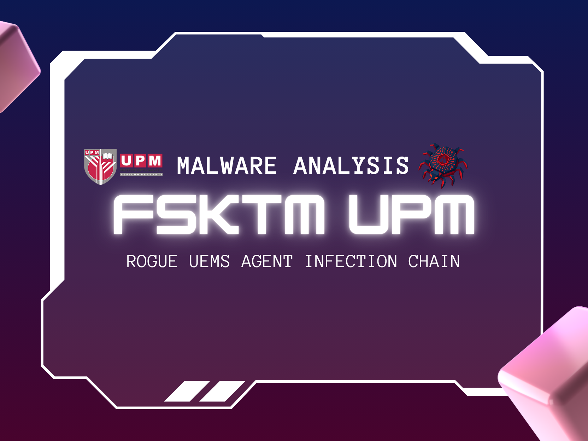

# Hi, I'm Muhammad Hazuan 👋

I'm a Computer Science undergraduate at Universiti Putra Malaysia focused on defensive security: malware analysis, SIEM engineering and secure infrastructure. I'm looking for a cybersecurity internship starting March 2027.

## Writeups

<table>
  <tr>
    <td width="50%" align="center">
       
      <b><a href="https://drive.google.com/file/d/1IoOfKmm7Jg2SZ2Joeu96vZHCoME-epAC/">FSKTM UPM Malware Analysis</a></b>
    <!-- </td>
    <td width="50%" align="center">
       
      <b><a href="WRITEUP_2_URL">[Writeup 2 title]</a></b>
    </td> -->
  </tr>
  <!-- <tr>
    <td width="50%" align="center">
       
      <b><a href="WRITEUP_3_URL">[Writeup 3 title]</a></b>
    </td>
    <td width="50%" align="center">
       
      <b><a href="WRITEUP_4_URL">[Writeup 4 title]</a></b>
    </td>
  </tr> -->
</table>

## Projects

### 🦠 Malware Analysis Lab
An isolated detonation environment (FlareVM + REMnux on Proxmox, behind a firewalled network) for safely running and observing live malware samples.
- Ran static and dynamic analysis on real-world samples and published reports with executive summaries, IoCs, threat intel and MITRE ATT&CK mapping.
- Reverse-engineered a four-stage infection chain from a WhatsApp campaign targeting my faculty: a malicious VHD (MOTW bypass) → DLL side-loading through a signed binary → encoded PowerShell downloader → rogue ManageEngine Endpoint Central agent for C2.
- 🔗 [link to reports / repo]

### 🛡️ Cybersecurity Homelab
A multi-zone virtualised network on Proxmox VE that simulates a segmented enterprise.
- Set up OPNsense as the perimeter firewall, with VLANs separating Offensive, Defensive and Malware Analysis zones.
- Deployed Wazuh SIEM across Windows and Linux endpoints, reaching a 90% true-positive rate across the attack scenarios I tested.
- 🔗 [link to repo / write-up]

### 🤖 Multimodal Malware Detection System (Final Year Project, in progress)
A web-based malware classifier with a two-stream late-fusion design. It combines classical ML on extracted features with a ResNet CNN that analyses the visual byte patterns of binaries.
- Benchmarked competing architectures and feature approaches against current literature before implementation.
- 🔗 [link to repo]

## Skills

| Area | Tools and examples |
|---|---|
| Malware analysis & RE | Ghidra, x64dbg, PE-bear, Detect It Easy, YARA, Procmon, CyberChef |
| Blue team | Wazuh, Sysmon, Suricata, MITRE ATT&CK mapping, detection engineering |
| Red team | Burp Suite, Nmap, Metasploit; web exploitation and cryptography in CTFs |
| Infrastructure | Proxmox VE, OPNsense, VLAN segmentation, Docker, Google Cloud Run, AWS |
| Languages | Python, Java, Bash, PowerShell, JavaScript, SQL |

## Also

- 🏆 Champion, 5th International Conference on Youth Hackathon (an AI digital safety platform with gamified phishing and scam awareness training)
- 🚩 Top 10, 8th UiTM Capture The Flag Competition (iCTFF8)
- 🎓 Founder and President, UPM Cybersecurity Club
- 📜 CompTIA Security+ (SY0-701), in progress

## Current focus

Finishing my malware detection FYP, writing more malware analysis reports, and studying for Security+.

## Get in touch

📧 hazuansadik3@gmail.com · 💼 [LinkedIn](https://www.linkedin.com/in/muhammadhazuan)
